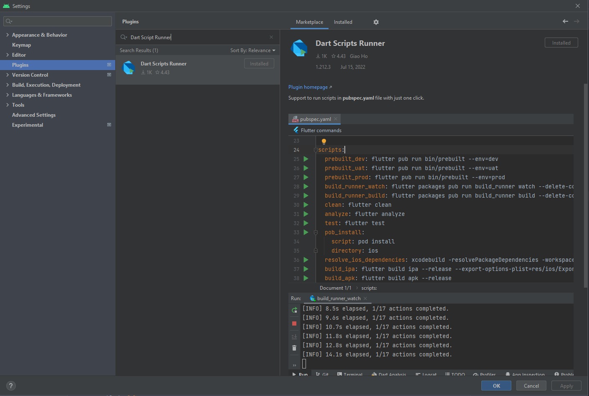
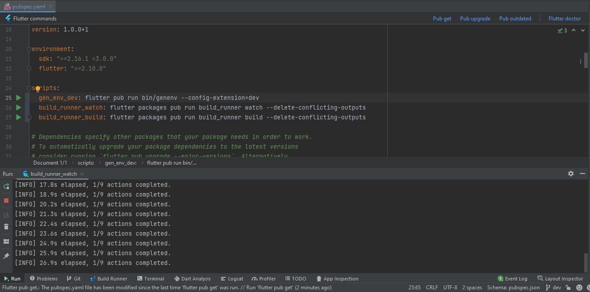
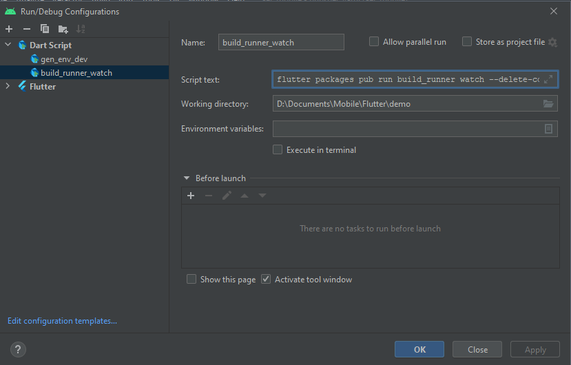

# Dart Scripts Runner

[](https://plugins.jetbrains.com/plugin/18726-dart-scripts-runner)
[](https://plugins.jetbrains.com/plugin/18726-dart-scripts-runner)
[](https://plugins.jetbrains.com/plugin/18726-dart-scripts-runner)
[](LICENSE)

An IntelliJ Platform plugin that allows you to define and execute custom scripts directly from your Dart and Flutter `pubspec.yaml` with a single click.

## Features

- **Gutter Run Icons**: Adds executable gutter icons directly beside each script declared in `pubspec.yaml`.
- **Integrated Terminal Execution**: Run scripts inside IntelliJ's built-in Terminal tab with full interactivity and ANSI color support.
- **Run Configurations Integration**: Auto-creates standard IntelliJ Run Configurations with support for environment variables, custom working directories, and quick re-runs.
- **Flexible Syntax**: Supports shorthand string commands or detailed object configurations per script.

## Installation

1. Open IDE settings (`Ctrl+Alt+S` on Windows/Linux, `Cmd+,` on macOS).
2. Navigate to **Plugins** > **Marketplace**.
3. Search for `Dart Scripts Runner`.
4. Click **Install** and restart the IDE if prompted.



## Usage

Add a `scripts` section to your `pubspec.yaml` file:

```yaml
scripts:
  # Shorthand: runs command in project root
  clean: flutter clean
  pub_get: flutter pub get
  build_runner: dart run build_runner build --delete-conflicting-outputs

  # Advanced options:
  pod_install:
    script: pod install       # Command to execute (required)
    directory: ./ios          # Working directory, relative or absolute (default: project root)
    terminal: true            # Run in terminal tab (default: false)
```

Click the **Run** icon on the gutter next to any script line to execute it.



### Configuration Options

| Option | Type | Default | Description |
|---|---|---|---|
| `script` | `string` | *(required)* | Shell command to execute |
| `directory` | `string` | `<project directory>` | Working directory (relative to project root or absolute) |
| `terminal` | `boolean` | `false` | Run inside built-in terminal (`true`) or console process (`false`) |

### Run Configuration

Each executed script creates a standard IDE Run Configuration where you can customize environment variables, working directory, and execution mode:



## Compatibility

Supports IntelliJ IDEA, Android Studio, and other IntelliJ-based IDEs supporting Dart/Flutter projects (versions `2020.1` through `2026.3+`).

## License

[Apache 2.0](LICENSE) © [Giao Ho](https://github.com/joutvhu)
